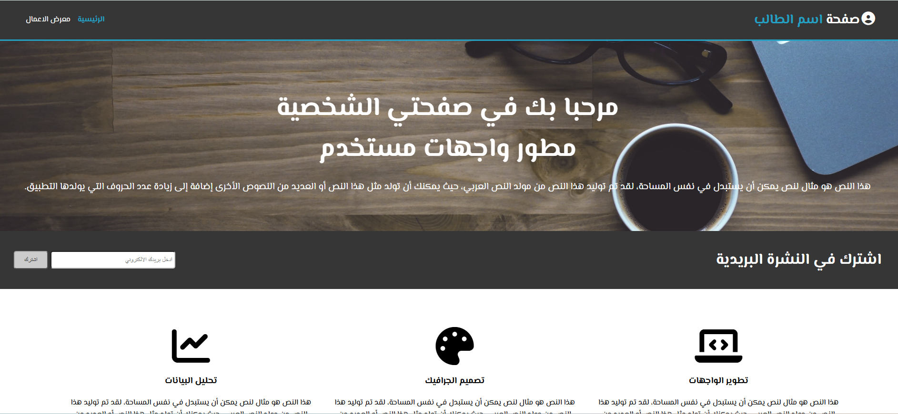

# My Profile Page — صفحتي الشخصية

A modern and responsive personal profile page built with HTML, CSS, and JavaScript as a capstone project for learning web development fundamentals.

---

## 📌 About the Project

**My Profile Page** is a responsive Arabic (RTL) personal portfolio website designed to showcase skills and projects in a clean and professional layout.

The project includes a **home page** with a hero section, newsletter subscription, and service cards, along with a **gallery page** featuring an interactive image slider with project descriptions.

This project was built as a final project for completing the **HTML + CSS + JavaScript** learning path.

---

## 🚀 Live Demo

> _Coming soon — deploy to GitHub Pages or Netlify and add the link here._

<!-- [View Live Demo](https://your-demo-url.com/) -->

---

## 📸 Screenshots

> _Add screenshots of your project here._

<!--  -->
<!--  -->

---

## ✨ Features

- ✅ Responsive design with CSS media queries
- ✅ Right-to-Left (RTL) Arabic layout
- ✅ Modern and clean user interface
- ✅ Interactive image slider with JavaScript
- ✅ Dynamic project descriptions linked to slider
- ✅ Newsletter subscription section
- ✅ Service cards with Font Awesome icons
- ✅ Multi-page navigation (Home + Gallery)
- ✅ Mobile-friendly layout
- ✅ Cross-browser compatible

---

## 🛠️ Technologies

| Technology | Usage |
|---|---|
| **HTML5** | Page structure and semantic markup |
| **CSS3** | Styling, Flexbox layout, and media queries |
| **JavaScript** | Interactive image slider and DOM manipulation |
| **Font Awesome 7** | Icons throughout the interface |
| **Google Fonts** | Arabic fonts (El Messiri) |

---

## 📂 Project Structure

```
remp-profile-1/
│
├── css/
│   ├── style.css          # Main stylesheet
│   └── slider.css         # Image slider styles
│
├── js/
│   └── slider.js          # Slider logic and DOM manipulation
│
├── img/
│   ├── backgron1.jpg      # Hero background image
│   ├── pek1.png           # Gallery image 1
│   ├── pek2.png           # Gallery image 2
│   ├── pek3.png           # Gallery image 3
│   ├── pek4.png           # Gallery image 4
│   └── pek5.png           # Gallery image 5
│
├── index.html             # Home page
├── gallery.html           # Gallery / Portfolio page
└── README.md
```

---

## 💻 Installation

1. Clone the repository:

```bash
git clone https://github.com/username/remp-profile-1.git
```

2. Navigate to the project directory:

```bash
cd remp-profile-1
```

3. Open `index.html` in your browser.

---

## 📱 Responsive Design

The interface has been designed to work across:

| Screen Size | Breakpoint |
|---|---|
| 📱 Mobile | `< 592px` — Header centers content |
| 📱 Tablet | `< 776px` — Newsletter section centers |
| 💻 Laptop/Desktop | `< 1154px` — Service boxes stack vertically |
| 🖥️ Large Desktop | Full horizontal layout |

---

## 📚 What I Learned

Through this project, I practiced:

- 🔹 Creating responsive layouts using **CSS Flexbox**
- 🔹 Working with **media queries** for different screen sizes
- 🔹 Building an **RTL (Right-to-Left)** Arabic interface
- 🔹 Implementing an **interactive image slider** with vanilla JavaScript
- 🔹 Using **DOM manipulation** (`querySelectorAll`, event listeners, `classList`)
- 🔹 Using **CSS transitions** for smooth animations (`transform`, `transition`)
- 🔹 Integrating **external libraries** (Font Awesome, Google Fonts via CDN)
- 🔹 Organizing a **multi-page frontend project** structure
- 🔹 Improving **spacing, typography**, and visual design consistency

---

## 🔮 Future Improvements

- [ ] Add smooth scroll animations and transitions
- [ ] Improve accessibility (ARIA labels, keyboard navigation)
- [ ] Add dark mode toggle
- [ ] Optimize images for better performance
- [ ] Add a contact form page
- [ ] Deploy to GitHub Pages
- [ ] Add auto-play functionality to the image slider
- [ ] Replace placeholder text with real content

---

## 👨‍💻 Author

**Mohammed Faez**
Frontend Web Developer

- GitHub: [your-github](https://github.com/mohammed-MFSA99)
- LinkedIn: [your-linkedin](https://www.linkedin.com/in/mohammed-faez-alameri)

---

## 📄 License

This project is available under the [MIT License](LICENSE).

